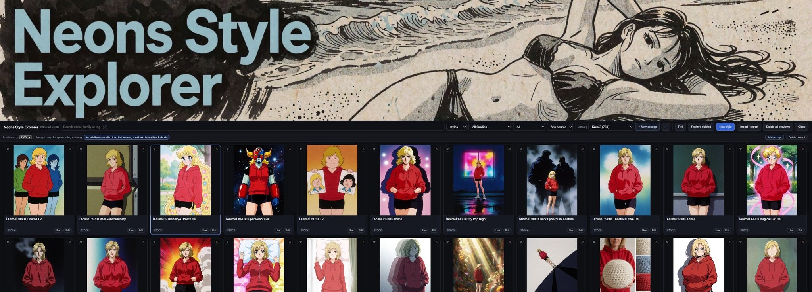
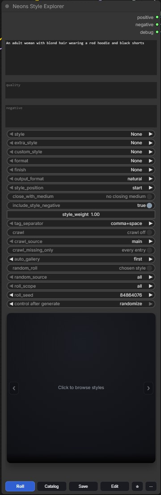
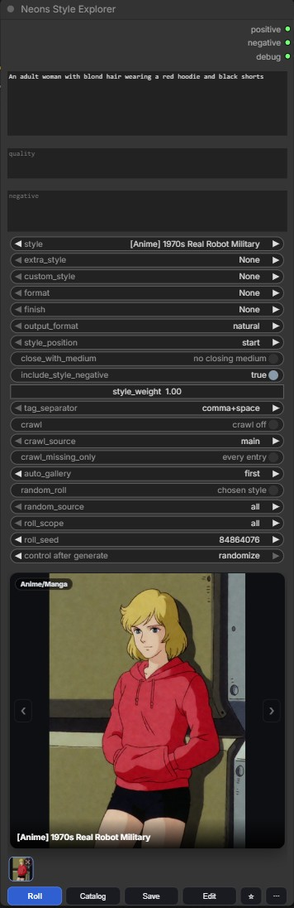

# Neons Style Explorer

A style catalog node for ComfyUI. A style entry is a **style prefix** and nothing
else: it describes how the picture is rendered and closes with the medium —
`... anime style image`, `... photograph style image`, `... cgi style image`.
No instructions to the model, no sentences about what the image contains.

Nodes (category **Neons**):

* **Neons Style Explorer** — text in, text out, plus the name of the style used
* **Neons Style Explorer (Encode)** — the same plus CLIP encode
* **Neons LoRA Explorer** — a LoRA loader with a preview gallery per model folder
* **Neons Model Explorer** — a checkpoint loader with the same gallery, and notes
* **Neons Gallery Capture** — headless equivalent of the Save button

**[Quick start](QUICKSTART.md)** · **[Read the manual](MANUAL.md)** · [pre-release audit](AUDIT.md) — every widget, the browser, previews, the
crawl workflow, catalogs and troubleshooting.

## What it looks like



| | |
|---|---|
|  |  |
| Prompt only — every slot on None, the node passes your prompt through. | A style chosen, with its family and preview on the node. |

**New here? [Read the quick start](QUICKSTART.md)** — six steps with pictures.

## Install

**ComfyUI Manager** — search for *Neons Style Explorer* and install, then restart
ComfyUI.

**Manually** — clone into `ComfyUI/custom_nodes/` and restart:

```bash
cd ComfyUI/custom_nodes
git clone https://github.com/Neon-Sparks/ComfyUI-NeonsStyleExplorer
```

Restart ComfyUI after installing or updating — a browser refresh loads the new
interface but not the node's HTTP routes, so new features fail until the process
restarts.

No extra dependencies: it uses Pillow and numpy, both of which ComfyUI already
ships. Python 3.9+.

## Output

```
masterpiece, best quality, Anime broadcast still, flat cel colouring in hard
shadow bands, simplified on-model faces, painted matte background, mild
compression softness and grain, TV-frame colour, anime style image, a woman on
a fire escape at night
```

```
masterpiece, best quality, (anime_screenshot:1.1), (anime_coloring:1.1),
(cel_shading:1.1), (film_grain:1.1), 1girl, rooftop
```

* `output_format` — natural | danbooru | natural + danbooru
* `style_weight` — a 1.0–5.0 slider; wraps the clause as `(clause:weight)` in natural mode and every style tag as `(tag:weight)` in booru modes
* `style_position` — put the style clause at the **start** or the **end**
* `quality` — a separate quality-prefix box, always kept at the very front
* three axes — `style`, `format` (what job the frame does), `finish` (a
  stackable realism qualifier)
* `random_roll` — a switch that rolls a style for every run, with
  `random_source` (all / main / extra / custom) choosing the pool, `roll_scope`
  narrowing it (all / family / favourites / recent / has preview / missing
  preview) and `roll_seed` plus its control-after-generate widget (set it to
  randomize so every run rolls anew; a seed of 0 does the same)
* `style_name` — an output carrying the style this run used, rolls and crawl
  steps included, for filenames, labels or **Neons Gallery Capture**
* settings that only matter while a switch is on — the crawl source, the dice's
  source and seed, the tag separator — stay folded away until it is
* **Named catalogs** — keep a separate preview set per model ("my Krea 2", "SDXL",
  a client project): each catalog has its own gallery, favourites and recents,
  while the style texts and your edits stay shared. Pick one from the toolbar,
  add one with **+ New catalog**
* **Crawl through** — a switch that walks the main style dropdown one entry per
  queued run instead of rolling, starting from the style you have selected, over
  whatever `roll_scope` selects; set
  `roll_scope` to *missing preview*, `auto_gallery` to *every*, queue a few
  hundred runs and the gallery fills itself in order
* **Favourites and recents** — star entries from the card or the node toolbar,
  filter the browser by them, and let the dice roll inside either list; every
  run records the style it used

## The panel

The preview scales with the node on both axes, the button row sits under it, and
the panel body is click-through so the node still drags from anywhere. Buttons:
**Roll**, **Catalog**, **Save**, **Edit**, and a `⋯` menu (browse formats and
finishes, new custom style, clear styles, delete shots). The composed
prompt updates live underneath.

## Random

`random_roll` rolls a style each run; `random_source` picks the pool — all,
main, extra or custom — and `roll_scope` narrows it (family, favourites,
recent, by preview state). The old `🎲 Random` entry in the dropdowns is gone;
a workflow that used it switches over on load.

## Catalog browser

Banner at the top that scrolls away under a sticky toolbar, then a virtualised
grid — only the visible cards are mounted, so a thousand entries scroll
smoothly. Search over name, alias, family and tags; filter by axis, family,
source and preview state; hover shows the clause; Edit opens the entry; JSON
import/export for style packs.

## Gallery

The gallery ships empty — nothing is bundled. Generate, then press **Save**: the last result becomes that style's preview.
Up to eight shots per style, click a thumbnail in the strip to make it the
cover, `auto_gallery` can fill them automatically. Previews are keyed on the
style's stable id, so renaming never orphans an image.

## LoRA node

**Neons LoRA Explorer** loads a LoRA and keeps a preview gallery beside it. The
list is ComfyUI's own `loras` folder, and the folders do the filing: a
top-level folder is a **gallery**, a folder inside it is a **family**, and loose
files land in **Unsorted**. No configuration.

```
loras/krea 2/film_grain.safetensors            gallery "krea 2"
loras/krea 2/portraits/soft_light.safetensors  gallery "krea 2", family "portraits"
loras/loose_one.safetensors                    gallery "Unsorted"
```

Each gallery keeps its own previews, so the same LoRA filed under two checkpoint
folders has two separate sets of images — you can see how it behaves on each
model instead of one mixed pile.

* **Gallery** opens the browser: search, filter by gallery, family, favourites
  or preview state, click a card to load that LoRA. **✕** on a card deletes its
  previews, **★** favourites it, **Rescan** re-reads the folder after you add
  LoRAs without restarting. The browser reopens on the search, filters and
  scroll position you left it on.
* **Trigger words** are edited under the preview and shown on every card. They
  come out of the node's **triggers** output, so the words travel with the LoRA
  straight into your prompt.
* **Save** files the newest generated image against the current LoRA. Saving is
  manual — no crawl, no auto-populate.
* **random_roll** loads a random LoRA each run; **roll_scope** keeps the dice
  inside the picked LoRA's gallery, its family, or your favourites, so it stays
  among the LoRAs made for the model you are using.
* Outputs: `model`, `clip`, `lora_name`, `triggers`.

Previews live in `user/loras/<gallery>/` and trigger words in
`user/loras/triggers.json`. Nothing is ever written to your loras folder.

## Model node

**Neons Model Explorer** is the LoRA explorer pointed at your base models — both
`checkpoints` and `diffusion_models`, each its own gallery so the gallery
dropdown switches between them. The folders do the filing, each top folder keeps its own previews, **Save** files
the newest image against the checkpoint that made it, and each one can carry a
**note** — the sampler, CFG and resolution it likes, which comes out of the
node as a string. No roll: a checkpoint is a choice, not a variation.

Outputs: `model`, `clip`, `vae`, `model_name`, `notes`. A diffusion model has no
CLIP or VAE of its own, so those stay empty for one — wire your own loaders.
If something is wired to them anyway, the node stops with a message saying so
instead of failing further down the graph.

## Style Explorer 2

**Neons Style Explorer 2** is a second, separate style node. The original is
untouched and both can sit in the same workflow, so you choose which to use.
Version 2 has its own catalog of **5,870 styles in 16 categories**, all
rewritten to one standard, plus 454 modifiers.

* **No giant dropdown.** The styles live in a browser, and the node keeps its
  selection as a line of text (`Oil Impasto, Film Noir:0.6`). ComfyUI starts
  and loads workflows no slower with the node installed.
* **The browser** has a category tree, 35 trait filters (moody, flat, vintage
  ...), instant search across every name, description and tag, favourites,
  your own collections, and previews you save from your own generations.
* **Blend up to three styles**, each with a weight.
* **strength** writes more or less of a style (light, standard, heavy) without
  emphasis syntax, which turbo models ignore.
* **output_as** writes natural language for Flux, Krea, Qwen and Z-Image type
  models, booru tags for SDXL, Illustrious and Pony models, or both.
* **Six modifier dropdowns**: lighting, palette, camera, mood, format, finish.
* **Dice.** Put `@favourites`, `@painting`, `@<collection>` or `@all` in the
  styles box and the node rolls a style from that set on every run.
* **LoRA triggers.** Three `lora_triggers` inputs take the `triggers` output of
  up to three Neons LoRA Explorer nodes and put the words at the very start
  of the prompt, as on the original node.
* **prompt_prefix** and **negative** boxes. The prefix leads the prompt; the
  negative is passed through as you wrote it. Version 2 styles add nothing to
  the negative, so leave it empty for turbo models.
* Outputs: `positive`, `negative`, `style_text`, `style_name`, `debug`. The
  **(Encode)** variant takes a CLIP and puts `positive_conditioning` and
  `negative_conditioning` in front of those.

Where a version 2 style was reworked from an original one, its preview is
copied across the first time you open the browser. See MANUAL.md, section 17c.

## Style Roller node

**Neons Style Roller** rolls style language instead of a whole style: a handful
of terms such as `painterly, caustic light, geometric shapes, muted palette`,
drawn from a list of more than 21,000. It needs nothing else from the pack, so
it works on its own, ahead of any prompt node.

* **kind** narrows the roll to what suits one sort of picture: realism, anime &
  manga, cartoon & animation, comics & print, painting, illustration & drawing,
  3D & games, graphic design, abstract & experimental, or all.
* **count** is how many terms to roll, 1 to 50.
* **seed** decides the roll. The same seed and settings give the same words,
  and a longer roll starts with the shorter one. 0 rolls afresh every run.
* **aspect** rolls one part of a look only (look & medium, lighting, colour,
  texture & surface, mood, composition & camera, era & movement, line &
  shape, effects & magic). Left on **any (balanced)**, the words are spread across all of them.
  **big changes** rolls the words that decide what kind of picture it is;
  **fine details** rolls the ones that adjust it.
* **vocabulary** chooses between everything, the well-known terms, the deep
  cuts, or only your own words.
* **theme** adds a flavour that cuts across everything else: retro & vintage,
  futuristic & cyber, dark & gothic, bright & playful, fantasy & mythic,
  historical & world, handmade & craft, nature & seasons, neon & glow, minimal
  & clean, ornate & detailed.
* **words_per_term** rolls plain single words (`gothic, rainbow, splatter`),
  short terms, or the longer descriptions.
* **output_as** writes plain phrases for natural-language models, or
  `booru_style_tags` for tag-trained ones, using the real tag where one exists.
* **weight** wraps each term as `(term:1.20)`.
* **always_include** / **never_include** pin words to every roll or keep them
  out; a word in never_include removes every term that contains it.
* **preview roll** shows the words without running the workflow. With a seed
  set, that is exactly what the next run will use.

* **keep these words** sets the seed to the one the words came from and fixes
  it, so a roll you like repeats.
* **save as style** turns the roll you are looking at into a style for Neons
  Style Explorer 2: a dialog asks for a name, lets you edit the words, and can
  attach the newest generated image as its preview.

A roll never repeats a term and never pairs opposites (no `monochrome` beside
`vivid palette`). Outputs: `text` (the words joined to whatever is wired into
the `text` input) and `words` (the rolled words alone).

Your own terms go in `user/roller_words.txt`, one per line. Optionally say what
a term is: `brass haze | lighting | painting anime`.

## The catalog

**3015 entries** — 1419 with every clause hand-written for this catalog, plus the 1596-entry imported **Extra** family, across nine families: photography & film 249, traditional painting 208, anime & manga 164, design & aesthetics 150, 3D & games 148, illustration 122, comics & print 83, experimental & material 79, western animation 68. Three axes — 2867 styles, 97 formats, 51 finishes. The Extra family is imported from ThetaCursed's Krea 2 style collection under its MIT licence; see `THIRD-PARTY-NOTICES.md`. Old `[Clio]` names are relabelled `[v2]`, and every merged duplicate keeps its old name as a search alias. `STYLES.md` lists everything.

```
tools/build_all.sh               # import + lint + index + docs + examples + tests
python3 tools/lint.py --all      # every finding
node tools/check_web.mjs         # UI: undefined calls and bad imports
python3 tests/test_compose.py    # 89 tests
python3 tools/security_probe.py  # attacks every route on a throwaway copy
```

The source of truth for the text is `tools/written/*.json`; `import_source.py`
merges it into `styles/`. The linter enforces the wording rules: the clause must
close with its medium, must not contain instruction or scope language, must not
name picture content, ≤380 characters, and every tag must exist in
`data/tags.txt`.

## Layout

```
catalog.py    loading, merging, caching, lookup, roll
catalogs.py   named catalogs, each with its own previews and favourites
compose.py    the one composer (the UI calls it over HTTP)
nodes.py      the nodes
gallery.py    preview gallery on disk
runs.py       per-prompt records, so a saved image gets the right style
loras.py      LoRA folders, previews, favourites, trigger words
bundle.py     catalog export / import as a zip
store.py      overrides / custom / hidden styles
styles/       the catalog, one file per family
data/tags.txt validated booru tag vocabulary
web/          api, css, panel, catalog_ui, lora, main
tools/        import, lint, harnesses, and the source in tools/written/
```

Contributions welcome — [CONTRIBUTING.md](CONTRIBUTING.md).
Security reports: [SECURITY.md](SECURITY.md).

MIT licensed.